<p align="center">
  
</p>

<p align="center">
  <a href="https://www.linkedin.com/in/daniel-stefan-reis/"></a>
  
</p>

```console
analyst@soc-lab:~$ cat perfil.txt
  Papel     Estudante de Cibersegurança · PUC-Campinas
  Alvo      NOC · Suporte N1/N2 · SOC N1
  Foco      Redes · Monitoramento · Logs · Hardening
  Lab       KVM (Kali · Win11 · Linux) + VPS Docker
```

Me chamo Daniel, sou estudante de bacharelado em Cibersegurança, Segurança defensiva e ofensiva e resposta a incidentes. Sou movido pela curiosidade por tecnologia e busco oportunidades para aprender e construir uma carreira na área. Aqui estão meus labs, montados e documentados em ambiente próprio.

### `> labs`

| Lab | Foco |
|---|---|
| [**offsec-labs**](https://github.com/innexosistemas-lang/offsec-labs) | Hub do lab: infraestrutura, arquitetura e trilhas NOC/SOC |
| [glpi-lab](https://github.com/innexosistemas-lang/glpi-lab) | Service desk: chamados, SLA, inventário |
| [zabbix-noc](https://github.com/innexosistemas-lang/zabbix-noc) | NOC: monitoramento e alertas com Zabbix + Grafana |
| [wazuh-soc](https://github.com/innexosistemas-lang/wazuh-soc) | SOC: SIEM com Wazuh + Sysmon, triagem de alertas |
| [attack-detection-web](https://github.com/innexosistemas-lang/attack-detection-web) | Ataque do Kali x regra que detecta (MITRE ATT&CK) |
| [active-directory](https://github.com/innexosistemas-lang/active-directory) | Active Directory: administração, ataque e detecção |
| [security-scripts](https://github.com/innexosistemas-lang/security-scripts) | Scripts Python para logs, portas, hashes e IOCs |
| [writeups](https://github.com/innexosistemas-lang/writeups) | TryHackMe e Hack The Box |

### `> toolkit`

<p>
  
  
  
  
  
  
  
  
  
  
</p>

### `> certifications`

```text
[x] Segurança em Linux na Era da IA ........... IBSEC · 2026
[~] Google Cybersecurity Professional Cert .... Coursera · em andamento
```

<p align="center">
  <sub><code>// monitorar, detectar, responder, documentar.</code></sub>
</p>
